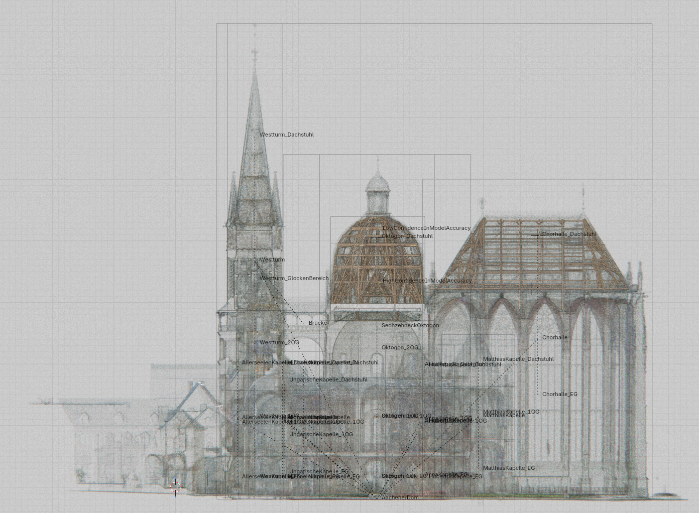

# Linking Restoration Works and Projects to Subspaces of Aachen Cathedral



## Overview

This repository provides a spatial reference basis for a Common Data Environment (CDE) concept applied to Aachen Cathedral. External projects (e.g., restoration campaigns, condition surveys, research datasets) could be linked to spatial containers that resemble physically and semantically meaningful subspaces of the building (e.g., `Oktogon_Dachstuhl`, `Chorhalle_Dachstuhl`). Rather than requiring all stakeholders to agree on a single type-level schema, the reference files below establish instance-level spatial anchors to which heterogeneous, distributed resources can be linked.

## Files

### 1. `aachen_cathedral_spatial_reference.blend`
A Blender scene containing spatially aligned documentation resources for the cathedral, including:
- Technical drawings (plans, sections, elevations)
- Point cloud data (PCD) from laser scanning campaigns
- Referenced/imported IFC geometry

The scene establishes a shared spatial frame in which all resources share a common coordinate system. It serves as a visual index and alignment check for subspace definitions, not as an authoritative geometric source.

### 2. `dachstuhl_geometry.ifc`
An IFC file containing the geometry of the roof structures (*Dachstühle*) of the cathedral, subdivided by structural bay/section. This file provides the authoritative, standards-based geometric representation from which spatial container boundaries are derived.


## License

These files are released under the **Creative Commons Attribution 4.0 International License (CC BY 4.0)**.

You are free to share and adapt this material for any purpose, including commercially, provided that you give appropriate credit, provide a link to the license, and indicate if changes were made.

Full license text: https://creativecommons.org/licenses/by/4.0/legalcode

```
Copyright (c) 2026
This work is licensed under a Creative Commons Attribution 4.0 International License.
```
